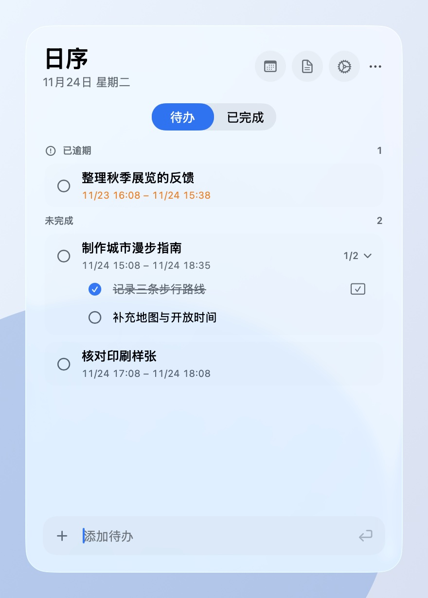
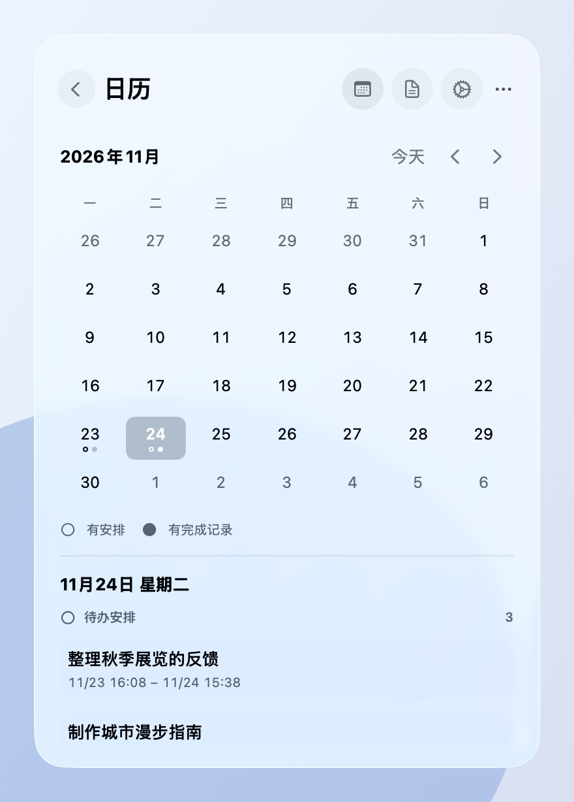
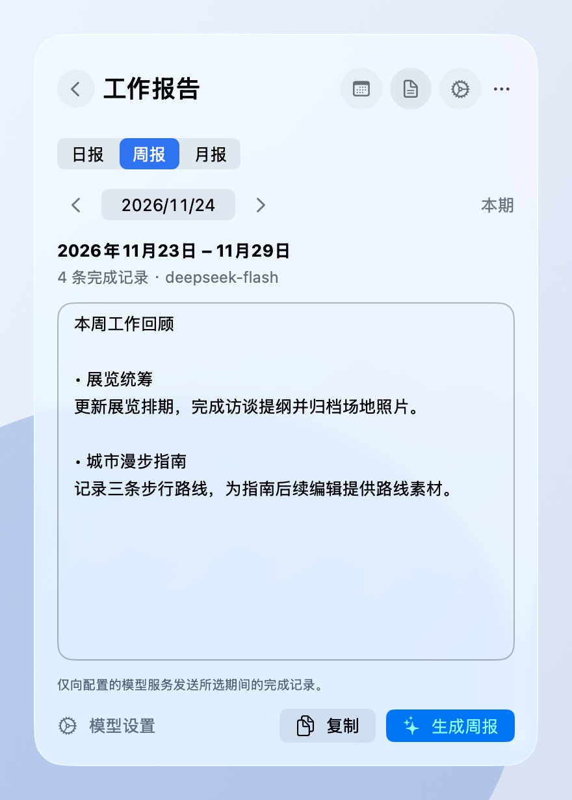

# 日序

原生 macOS 菜单栏应用，用来维护一张待办清单、记录每日产出，并把已完成的工作整理成日报、周报和月报。

点击菜单栏或 Dock 的日序图标，即可在该入口旁打开面板。在「设置 → 外观」可以调整玻璃透明度。在「设置 → 通用」可以开启悬停显示面板。需要 macOS 26 或更新版本。

## 界面预览

| 待办与子项 | 日历 | 工作报告 |
| --- | --- | --- |
|  |  |  |

截图使用示例数据。

## 下载安装

从 [GitHub Releases](https://github.com/Merenguelkl/rixu/releases/latest) 下载 `Rixu-*-arm64.dmg`。打开磁盘映像，把「日序」拖到「应用程序」，再从「应用程序」打开。

预构建安装包适用于 **Apple 芯片和 macOS 26 或更新版本**。安装包使用临时签名，未经过 Apple 公证，首次打开时 macOS 可能提示无法验证开发者。

## 功能

- 默认按 `⌃⌥⌘R` 即可在任何应用中调出日序，在「设置 → 通用」可以重录快捷键。在输入栏按 Return 保存，按 Esc 收起面板。
- 左侧加号可打开完整编辑器，设置时间范围或拆分子项。误完成或删除后可在清单底部撤销。
- 逾期任务固定在清单顶部。子项可以按顺序勾选，全部完成后再确认完成父任务。标记为「单独记入 Done」的子项按实际完成日计入报告。
- 在「已完成」中切换日期、补录事项或撤销完成。日历可以同时查看所选日期的待办安排和完成记录。
- 从弹层顶部进入日历、工作报告或设置，点左上角的返回键回到清单。「设置 → 模型」支持填写兼容 OpenAI Chat Completions 的 API 地址、API Key 和模型 ID。可粘贴密钥、获取模型列表或直接测试指定模型。
- 按天、自然周或自然月生成报告。生成时只向已配置的模型服务发送所选期间的完成素材。草稿可编辑和复制，在当前应用运行期间保留。
- 任务和完成记录保存在 `~/Library/Application Support/Rixu/tasks.json`，API Key 按服务地址分别保存在 macOS 钥匙串。

## 本地构建

使用带 macOS 26 SDK 的 Xcode 或 Command Line Tools，以及 Swift 6.2 或更新版本。在项目目录运行：

```sh
./scripts/build-app.sh
```

构建脚本会输出本机签名的 `dist/日序.app`。

运行 `./scripts/build-dmg.sh` 可以在本机生成同样的拖拽式安装包，文件位于 `dist/`。

## 软件更新

支持 OTA 的安装包可在「设置 → 通用 → 软件更新」手动检查更新。日序运行时默认会在后台检查，也可以自行开启「自动下载并安装」。首次从旧版迁移时，从 GitHub Releases 安装一次带 OTA 的版本即可。

### 打包 OTA 正式版

官方 OTA 公钥位于 `scripts/ota-public-key.txt`。每次正式发版都使用 macOS 钥匙串中 `rixu-release` 账户对应的发布密钥。

```sh
./scripts/build-ota.sh
```

构建脚本使用固定版本的 Sparkle 并校验下载内容。发版时，在与应用版本一致的 `v<版本号>` GitHub Release 草稿中同时上传 `Rixu-*.dmg`、`Rixu-*.zip` 和 `appcast.xml`，再将该 Release 发布为最新正式版。应用通过 Sparkle 公钥验证更新清单和下载包。签名后的 ZIP 和 XML 需要原样上传。

## 更新日志

参见 [CHANGELOG.md](CHANGELOG.md)。

## 许可证

[MIT](LICENSE)
